# Vexel 0.6.0b1 界面一览

以下截图来自 macOS 上的桌面版，数据为内置生成器合成的液滴视频（已知真值）。

## 1. 首次启动

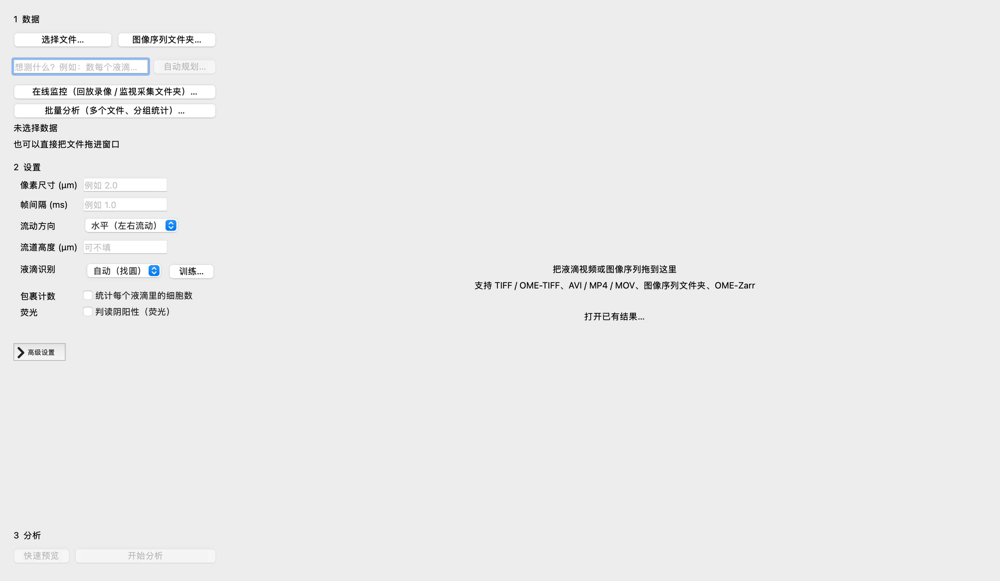

左栏按“数据 → 设置 → 分析”三步操作；右上角的引导栏随时提示下一步，没有数据时可以先试用示例数据。

## 2. 分析结果：包裹计数

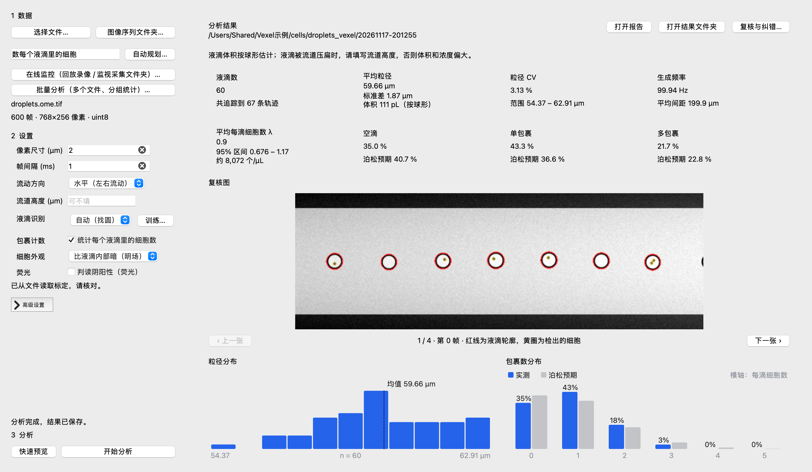

液滴数、粒径与 CV、生成频率、体积；每滴平均细胞数 λ 及 95% 区间，空滴、单包裹、多包裹比例与泊松预期对比。复核图上红线为液滴轮廓、黄圈为检出的细胞；下方是粒径分布和包裹数分布。

## 3. 自动规划

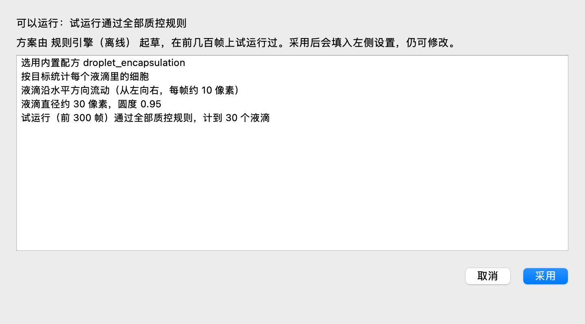

写一句目标（如“数每个液滴里的细胞”），Vexel 看一遍数据、起草设置、在前几百帧试运行，并列出每条理由，确认后填入设置。可选用 Claude、DeepSeek、通义千问、Gemini、本地模型，或完全离线的规则引擎。

## 4. 分析结果：荧光阴阳判读（数字检测）

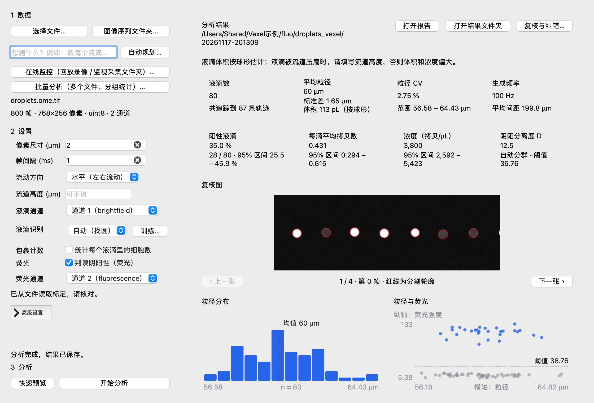

明场找液滴，荧光通道判读阴阳：阳性比例与 Wilson 区间、每滴拷贝数、浓度、两群分离度；右下为粒径对荧光的散点图和自动阈值。

## 5. 复核与纠错

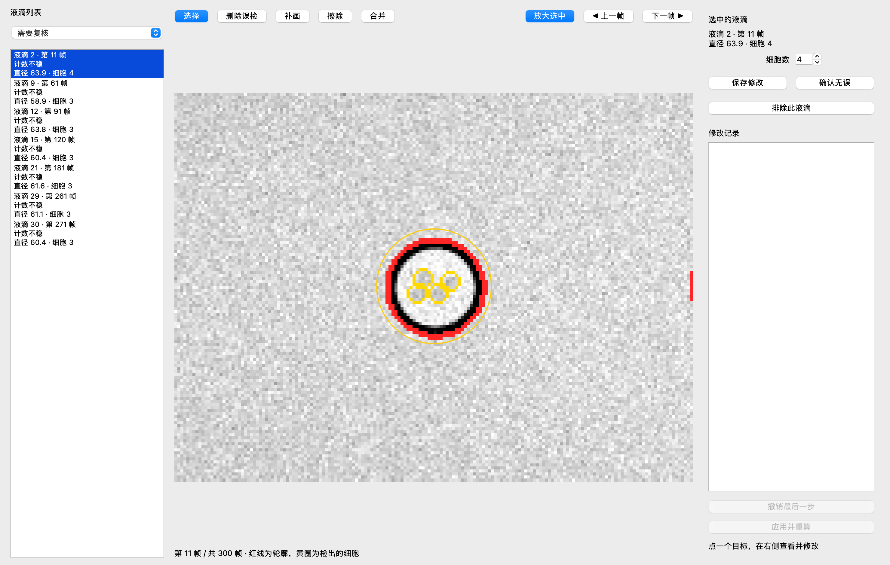

软件把计数不稳、形状异常等可疑液滴列在左侧；放大查看，可改细胞数、删除误检、补画、合并或排除，全部记入修改记录，再“应用并重算”。

## 6. 画笔训练

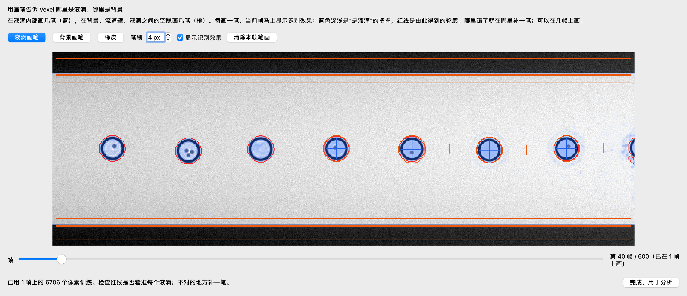

液滴轮廓找不准时，在液滴内部和背景各画几笔，马上看到识别效果（蓝色深浅为把握，红线为轮廓），不对的地方补一笔即可。

## 7. 在线监控

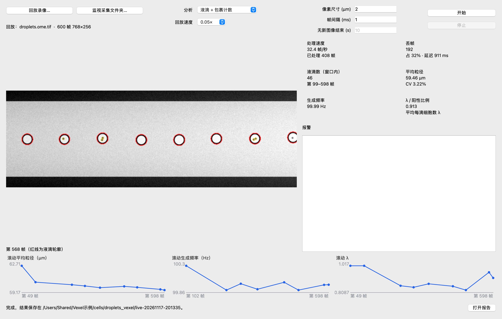

回放录像或监视采集文件夹，边采集边分析：当前帧、滚动粒径、频率和 λ 曲线、处理速度与丢帧、超限与漂移报警。

## 8. 批量分析与分组统计

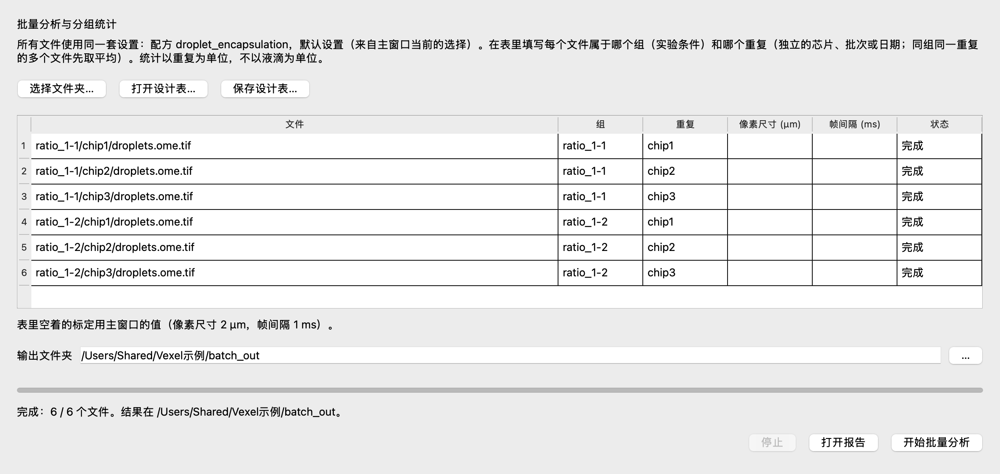

选一个文件夹，子文件夹名自动填作“组”（实验条件）和“重复”（芯片、批次）；所有文件用同一套设置无人值守地分析，出错的文件只记录、不中断，可随时停止并续跑。

## 9. 批量报告

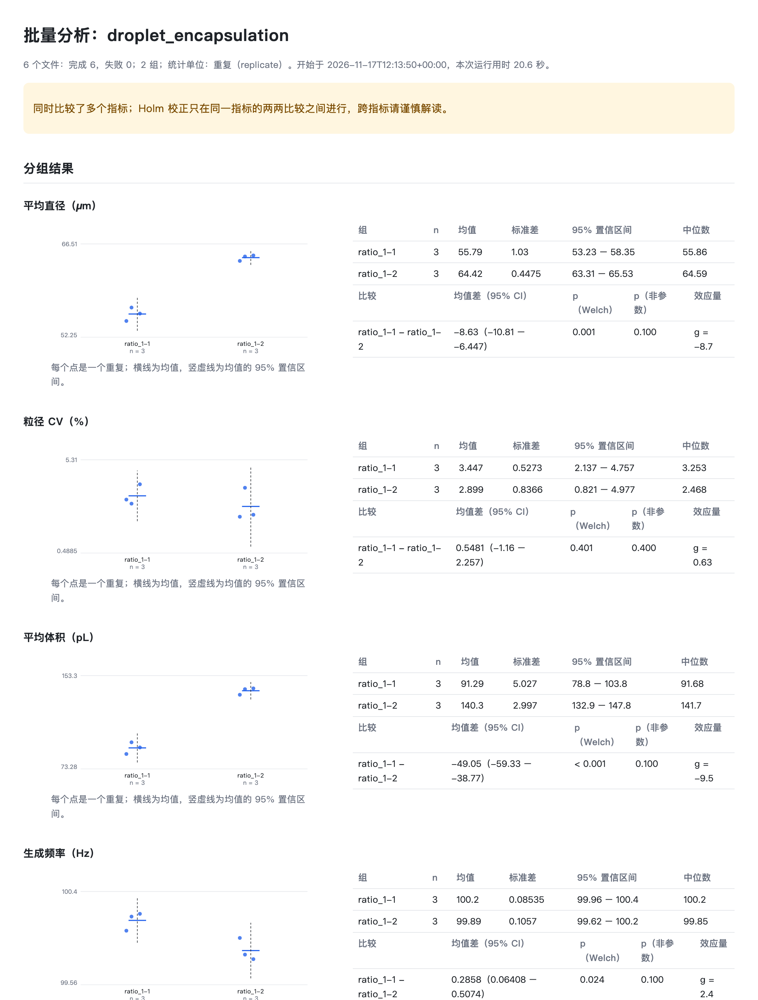

以重复为统计单位（不以液滴为单位）：每个指标一张分组图（每点一个重复，均值与 95% 置信区间）、描述统计、Welch t 检验与效应量；另附中英文方法段落和可独立复现全部结果的脚本。

## 10. 单次分析报告

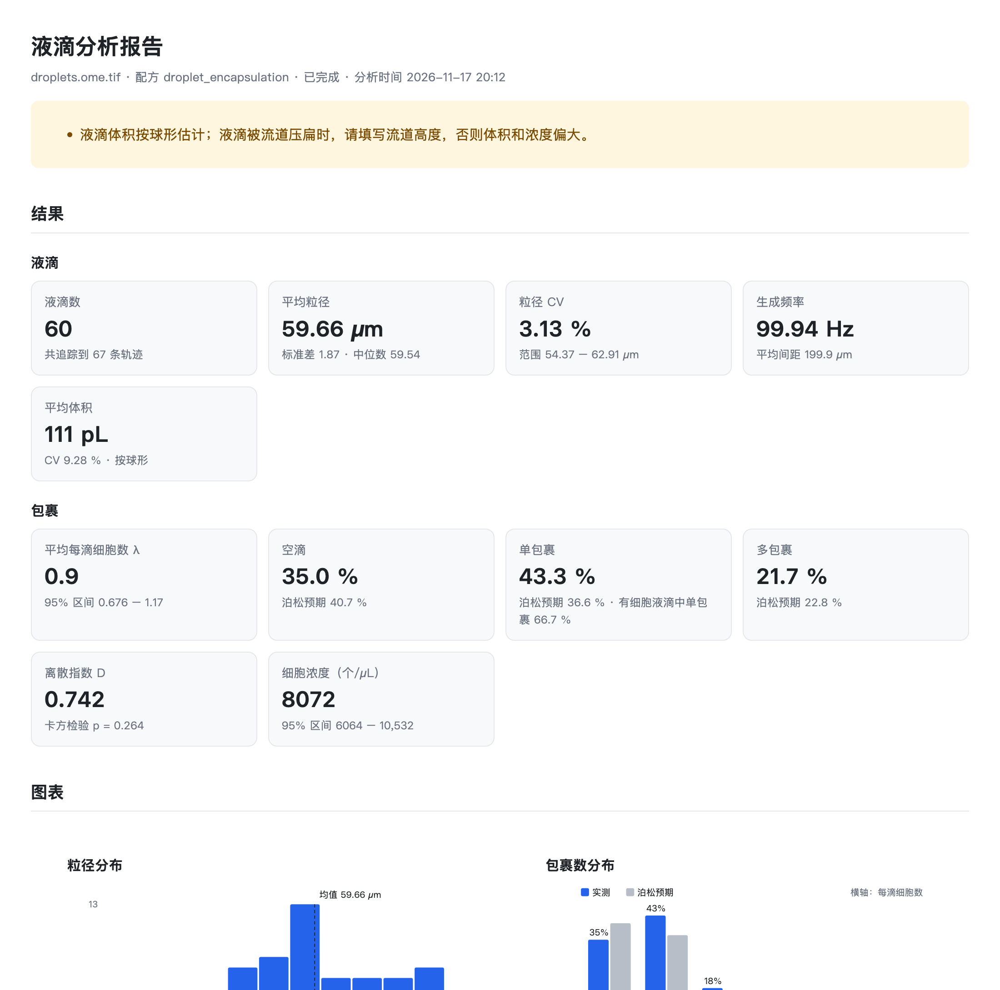

单个 HTML 文件，可直接发送或打印：结果卡片、图表、复核图、可疑液滴、中英文方法段落和完整溯源记录。

## 11. 规划模型设置

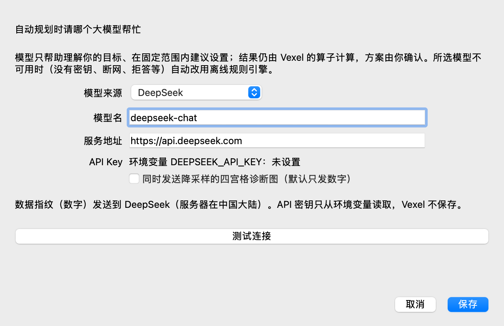

选择自动规划时请哪个大模型帮忙；密钥只从环境变量读取、不保存；默认只发送数据指纹中的数字，不发图像。
